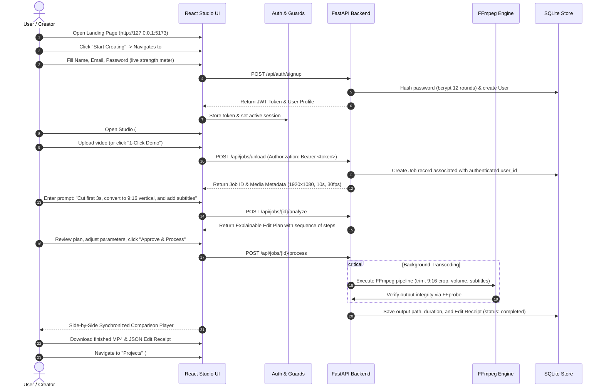

# ClipPilot AI — Prompt-to-Video Editing Studio

> **"Your words. Your vision. Your finished video."**  
> *IncuBrix Selection Submission | PS2: Prompt-Based Video Editing Engine + Secure Authentication*

[](TEST_REPORT.md)
[](TEST_REPORT.md)
[](https://ffmpeg.org)
[](https://fastapi.tiangolo.com)
[](https://vitejs.dev)

---

## 1. Project Overview & Problem Statement

### The Problem (PS2)
Traditional video editing requires hours of manual timeline maneuvering: slicing frames, calculating aspect ratios across social channels (16:9, 9:16, 1:1), scrubbing for dead air, and formatting subtitles. Existing consumer AI editors often rely on opaque black-box cloud APIs without allowing creators to inspect or modify what will actually happen to their footage, and developer tools frequently lack secure user isolation and a polished creator-first interface.

### The Solution: ClipPilot AI
**ClipPilot AI** is a professional prompt-to-video editing engine equipped with:
1. **A Vibrant, Modern Creator UI:** Designed with an editorial warm off-white surface, deep ink typography, electric violet and cyan accents, and clear visual hierarchy.
2. **Secure, Persistent Authentication:** Backend-managed account lifecycle with `bcrypt` password hashing, PyJWT tokens (supporting Bearer headers and HttpOnly cookies), sliding-window brute-force rate limiting, and route guards.
3. **Authoritative Project Ownership:** Users own their private projects and video outputs with strict cross-user isolation (`401 Unauthorized` for unauthenticated requests, `403 Forbidden` across all endpoints for cross-user data).
4. **Transparent, Explainable Editing:** Translates natural-language commands into a **typed, editable Edit Plan** before running real FFmpeg 9.0 media transformations with millisecond accuracy.
5. **Zero Paid API Lock-In:** 100% operational offline using local deterministic rule-based NLP and local FFmpeg transcoding.

---

## 2. System Architecture

```mermaid
graph TD
    User["Creator / User"] -->|Browser Request| UI["ClipPilot React App (Port 5173)"]
    
    subgraph Frontend ["Frontend Application (React 18 + Vite + TypeScript)"]
        UI --> Landing["Landing Page (#landing)"]
        UI --> Auth["Auth Pages (#login, #signup)"]
        UI --> Studio["Studio Workspace (#studio)"]
        UI --> Projects["User Projects (#projects)"]
        
        Auth --> AuthCtx["AuthContext & Route Guards"]
        Studio --> Upload["Video Upload & Drag-Drop"]
        Studio --> Player["HTML5 Video Player & Metadata Pills"]
        Studio --> Presets["Creator Presets (TikTok, YT, IG)"]
        Studio --> PlanUI["Explainable Edit Plan Inspector"]
        Studio --> Compare["Original vs. Edited Synchronized Player"]
        Studio --> ReceiptUI["Audit Edit Receipt & JSON Downloader"]
    end
    
    UI -->|Authenticated REST Requests (JWT)| API["FastAPI Backend Engine (Port 8000)"]
    
    subgraph Backend ["Backend Architecture (Python 3.10+)"]
        API --> AuthAPI["Auth Service (bcrypt + JWT + Rate Limiter)"]
        API --> JobAPI["Jobs API & Authorization Guard (verify_job_access)"]
        API --> Inspector["FFprobe Media Inspector"]
        API --> Parser["Deterministic NLP Prompt Parser"]
        API --> Detector["Silence Detection Engine"]
        API --> Transcriber["Speech & Subtitle Generator"]
        API --> Processor["Video Processor (FFmpeg 9.0)"]
        API --> DB[("SQLite Database (users & jobs)")]
    end
    
    Processor -->|Transcoded MP4| Storage["Per-Job Isolated Disk Storage"]
    Storage -->|Stream Video / Download| User
```

---

## 3. End-to-End User Journey



---

## 4. Visual Identity & Design System

ClipPilot AI features an editorial creative-tech aesthetic:
- **Primary Surfaces:** Crisp warm off-white (`#F8F9FC`) and elevated card white (`#FFFFFF`) with subtle slate borders (`#E2E8F0`).
- **Typography:** Deep ink slate (`#0F172A`) with refined secondary neutral (`#64748B`).
- **Accent Palette:**
  - **Electric Violet (`#6366F1`) & Indigo (`#4F46E5`):** AI intelligence, primary CTA buttons, and brand gradients.
  - **Bright Cyan (`#06B6D4`):** Real-time progress bars, video specs, and active playback indicators.
  - **Coral & Pink (`#F43F5E`):** Selected edit highlights, delete actions, and silence markers.
  - **Emerald Green (`#10B981`):** Verified operations, completion badges, and strength meters.
- **Micro-Interactions:** Smooth focus outlines, synchronized video scrubbers, interactive silence checkboxes, and loading spinners.

---

## 5. Security & Authentication Architecture

- **Password Hashing:** Passwords hashed with `bcrypt` (12 salt rounds). Zero raw passwords stored in memory or database.
- **Session Tokens:** Signed JSON Web Tokens (PyJWT) with configurable expiration (24h standard, 30 days for Remember Me).
- **Dual Transport:** Supports both HTTP `Authorization: Bearer <token>` and `clippilot_token` HttpOnly cookie.
- **Brute-Force Rate Limiting:** In-memory sliding-window limiter restricts failed login attempts (maximum 5 attempts per 60 seconds per IP+email pair).
- **Generic Errors:** Returns generic `"Invalid email or password"` responses to prevent account enumeration.
- **Authoritative Authorization Guard:** `verify_job_access()` ensures users cannot access or tamper with other users' jobs:
  - Custom jobs require authentication (`401 Unauthorized`).
  - Cross-user job access, downloads, and deletions return `403 Forbidden`.
  - Public demo jobs (`is_demo=True`) remain accessible for evaluation without leaking private data.
- **Subprocess Safety:** FFmpeg/FFprobe invocations use strict argument lists (`shell=False`), completely eliminating command injection attacks.
- **Path Traversal Protection:** User filenames are sanitized, and files are stored in unique UUID-keyed directories (`storage/uploads/{uuid}/`).

---

## 6. Key Differentiators & Judge-Impressive Features

| Feature | Description | Implementation |
|---|---|---|
| **Explainable Edit Plan** | Breaks natural-language instructions into discrete, typed, visual steps. Creators can inspect parameters before approving execution. | `EditPlanInspector.tsx`, `prompt_parser.py` |
| **Original vs. Edited Comparison** | Synchronized side-by-side video playback with live transformation audit metrics (duration delta, crop factor, speed). | `ComparisonViewer.tsx` |
| **Smart Silence Review** | Detects silent pauses (`< -30dB, >= 0.5s`) using FFmpeg's `silencedetect` audio filter and provides interactive cut checkboxes. | `SilenceDetector.py`, `SilenceReviewModal.tsx` |
| **Creator Presets** | 1-Click presets for **TikTok / Reels (9:16 vertical crop)**, **YouTube Standard (16:9 1080p)**, **Square Post (1:1)**, and **Subtitle-First Video**. | `CreatorPresets.tsx` |
| **Cryptographic Edit Receipt** | Generates an audit JSON log containing input/output metadata, prompt text, applied steps, and execution duration. | `EditReceiptModal.tsx`, `/api/jobs/{id}/receipt` |
| **User Projects Workspace** | Private creator dashboard displaying project status, specs, prompt summary, direct MP4 downloads, and audit logs. | `ProjectsPage.tsx`, `GET /api/jobs` |
| **1-Click Reproducible Demo** | Bundles synthetic talking-head video allowing immediate evaluation without requiring manual video uploads. | `POST /api/jobs/demo`, `generate_sample_videos.py` |

---

## 7. Supported Natural-Language Operations

| Operation | Natural-Language Prompt Example | Resulting FFmpeg Action |
|---|---|---|
| **Trim Beginning** | *"Remove the first 5 seconds"*, *"Cut opening 3s"* | Fast seek `-ss 5.0` |
| **Trim Ending** | *"Cut the last 4 seconds"*, *"Trim ending 5s"* | Relative seek `-to (duration - 4.0)` |
| **Extract Time Range** | *"Keep from 0:02 to 0:08"*, *"Slice between 5 and 15s"* | Interval seek `-ss 2.0 -to 8.0` |
| **Keep Opening** | *"Keep the first 5 seconds"* | Segment extract `-t 5.0` |
| **Aspect Ratio (9:16)** | *"Convert to 9:16 vertical for TikTok"* | `scale=1080:1920:force_original_aspect_ratio=increase,crop=1080:1920` |
| **Aspect Ratio (1:1)** | *"Make it 1:1 square for Instagram"* | `scale=1080:1080:force_original_aspect_ratio=increase,crop=1080:1080` |
| **Aspect Ratio (16:9)** | *"Change to landscape 16:9 widescreen"* | `scale=1920:1080:force_original_aspect_ratio=increase,crop=1920:1080` |
| **Resolution Standards** | *"Export at 1080p"*, *"Convert to 720p HD"* | Standardized dimensions preserving aspect ratio |
| **Audio Volume** | *"Boost volume by 50%"*, *"Double the volume"*, *"Mute"* | `volume=1.5` or `volume=2.0` or `-an` |
| **Color Adjustment** | *"Make it brighter"*, *"Boost contrast"* | `eq=brightness=0.15:contrast=1.3` |
| **Silence Removal** | *"Detect and remove silent pauses"* | `silencedetect` + segment re-stitching |
| **Subtitle Burning** | *"Add subtitles"*, *"Burn captions into video"* | SRT generation + `subtitles` filter with font styling |

---

## 8. Windows Setup & Installation Instructions

### Prerequisites
- Windows 10 or 11
- Python 3.10 or higher
- Node.js v18 or higher (v22 recommended)
- FFmpeg (Gyan Essentials build automatically detected if installed via Winget)

### Step 1: Install FFmpeg (if not already installed)
In PowerShell:
```powershell
winget install Gyan.FFmpeg.Essentials --accept-source-agreements --accept-package-agreements
```
*ClipPilot automatically detects the Winget Gyan Essentials package path without requiring a system reboot.*

### Step 2: Navigate to the Workspace
```powershell
cd "d:\MUKI PROJECT\inbix"
```

### Step 3: Install Backend Python Dependencies
```powershell
cd backend
python -m pip install fastapi uvicorn[standard] pydantic sqlalchemy httpx pytest pytest-asyncio python-multipart passlib[bcrypt] bcrypt pyjwt
cd ..
```

### Step 4: Install Frontend Node Dependencies
```powershell
cd frontend
npm install
cd ..
```

### Step 5: Launch the Application (One-Click)
Run the Windows launcher script:
```powershell
.\scripts\run_dev.bat
```

Alternatively, run backend and frontend in separate terminals:

**Terminal 1 (Backend API):**
```powershell
cd backend
python -m uvicorn app.main:app --host 127.0.0.1 --port 8000 --reload
```

**Terminal 2 (Frontend Studio UI):**
```powershell
cd frontend
npm run dev -- --host 127.0.0.1 --port 5173
```

- **Frontend Application:** `http://127.0.0.1:5173`
- **Backend API:** `http://127.0.0.1:8000`
- **Interactive Swagger Docs:** `http://127.0.0.1:8000/docs`

---

## 9. Automated Testing & Verification

ClipPilot AI includes 32 automated Pytest unit and security tests and an 11-stage live E2E verification suite:

```powershell
# 1. Run backend Pytest suite (32 tests)
cd backend
python -m pytest tests -v

# 2. Run live End-to-End system verification
cd ..
python scripts\verify_e2e.py

# 3. Build frontend bundle
cd frontend
npm run build
```

### Test Suite Breakdown:
- **`test_auth.py` (8 tests):** Registration, validation, duplicate prevention, login, generic 401s, logout, unauthenticated 401 rejection, cross-user 403 isolation.
- **`test_prompt_parser.py` (11 tests):** Natural language variations, trim distinctions, aspect ratios, volume scaling, silence, invalid ranges, and repair suggestions.
- **`test_video_processor.py` (6 tests):** Real FFmpeg operations on synthetic test media, silence detection, aspect crop, resolution change, audio-less video handling, and subtitle burning.
- **`test_api_jobs.py` (4 tests):** Health check, system capability reporting, 1-click demo lifecycle, and invalid file rejection.
- **`test_security.py` (3 tests):** Command injection blocking, path traversal prevention, and Windows subtitle filter path escaping.

---

## 10. Evaluator 3-Minute Demonstration Script

1. **Open Landing Page:** Navigate to `http://127.0.0.1:5173`. Notice the hero headline *"Your words. Your vision. Your finished video."*, interactive feature sections, and pipeline breakdown.
2. **Create Account:** Click **"Start Creating"** or **"Sign Up"**. Enter your name, email, and password. Notice the live password strength indicator and validation checkmarks.
3. **Session Verification:** After signup, observe the top navigation bar displaying your initials avatar (e.g. `JD`) and a dropdown menu with your email.
4. **Launch Demo Project:** Click **"Explore Demo"** or **"1-Click Demo"** in the Studio.
5. **Inspect Media Specs:** Observe the synthetic talking-head video loading with metadata pills: `Duration: 10.0s`, `1920x1080 (16:9)`, `30 FPS`, `Audio: AAC`.
6. **Inspect Explainable Plan:** See the pre-loaded prompt:
   *"Cut the first 3 seconds, convert to 9:16 vertical for TikTok, boost volume by 50%, and add subtitles"*.
   The engine translates this into 4 verified steps:
   - Step 1: `TRIM START` (3.0s)
   - Step 2: `ASPECT RATIO` (9:16 Portrait Crop)
   - Step 3: `AUDIO VOLUME` (150%)
   - Step 4: `SUBTITLES` (Burned SRT Captions)
7. **Smart Silence Review:** Click **"Review Detected Cuts"** to inspect detected silence pauses (`3.02s` to `6.01s`) with interactive checkboxes.
8. **Approve & Process:** Click **"Approve & Process Video"**. Watch the progress bar advance (`queued` &rarr; `processing` &rarr; `completed` in ~1.5s).
9. **Synchronized Comparison:** In the **Original vs. Processed Output** view, click **"Play Sync"** to watch both videos play simultaneously side-by-side.
10. **View Edit Receipt:** Click **"Edit Receipt"** to view the audit log and download the verified JSON report.
11. **User Projects Workspace:** Click **"Projects"** in the top navigation bar to view your private video library, metadata, and download links.

---

## 11. Project Directory Structure

```
d:/MUKI PROJECT/inbix/
├── backend/
│   ├── app/
│   │   ├── api/
│   │   │   ├── endpoints/
│   │   │   │   ├── auth.py             # User signup, login, session, logout
│   │   │   │   ├── jobs.py             # Video jobs API with verify_job_access
│   │   │   │   ├── health.py           # Health check endpoint
│   │   │   │   └── capabilities.py     # System & FFmpeg capability probe
│   │   ├── core/
│   │   │   ├── config.py               # App configuration & env vars
│   │   │   ├── deps.py                 # get_current_user & rate limiter
│   │   │   ├── security.py             # bcrypt hashing & PyJWT encoding
│   │   │   └── storage.py              # Isolated directory manager
│   │   ├── database/
│   │   │   ├── session.py              # SQLite engine & auto-migration
│   │   │   └── models.py               # UserModel and JobModel schemas
│   │   ├── schemas/
│   │   │   ├── auth.py                 # Pydantic v2 schemas for auth
│   │   │   ├── edit_plan.py            # Typed EditPlan and Operation models
│   │   │   ├── job.py                  # Job request and response models
│   │   │   └── capabilities.py         # System capability response models
│   │   ├── services/
│   │   │   ├── ffmpeg_finder.py        # WinGet / PATH / local FFmpeg finder
│   │   │   ├── media_inspector.py      # FFprobe metadata extraction
│   │   │   ├── prompt_parser.py        # NLP rule-based parser
│   │   │   ├── silence_detector.py     # silencedetect audio analyzer
│   │   │   ├── transcriber.py          # SRT subtitle generator
│   │   │   └── video_processor.py      # FFmpeg transcode & filter pipeline
│   │   └── main.py                     # FastAPI application setup & routers
│   ├── tests/
│   │   ├── conftest.py
│   │   ├── test_auth.py                # 8 auth & isolation tests
│   │   ├── test_prompt_parser.py       # 11 prompt parsing tests
│   │   ├── test_video_processor.py     # 6 FFmpeg video transcode tests
│   │   ├── test_api_jobs.py            # 4 jobs API & demo tests
│   │   └── test_security.py            # 3 input security & traversal tests
│   └── requirements.txt
├── frontend/
│   ├── src/
│   │   ├── components/
│   │   │   ├── Navbar.tsx              # Brand logo, nav links, avatar dropdown
│   │   │   ├── VideoUpload.tsx         # Drag & drop upload + demo trigger
│   │   │   ├── VideoPlayer.tsx         # HTML5 player with metadata pills
│   │   │   ├── PromptEditor.tsx        # Natural language prompt editor
│   │   │   ├── EditPlanInspector.tsx   # Visual explainable edit plan
│   │   │   ├── ComparisonViewer.tsx    # Synchronized dual video player
│   │   │   ├── SilenceReviewModal.tsx  # Silence interval reviewer
│   │   │   ├── CreatorPresets.tsx      # TikTok, YouTube, Instagram chips
│   │   │   ├── CapabilitiesModal.tsx   # System diagnostic information
│   │   │   └── EditReceiptModal.tsx    # JSON audit log viewer
│   │   ├── context/
│   │   │   └── AuthContext.tsx         # Reactive auth provider & session hook
│   │   ├── pages/
│   │   │   ├── LandingPage.tsx         # High-converting public landing page
│   │   │   ├── LoginPage.tsx           # Two-column login with Caps Lock check
│   │   │   ├── SignupPage.tsx          # Two-column signup with strength meter
│   │   │   ├── StudioPage.tsx          # Main video editing workspace
│   │   │   └── ProjectsPage.tsx        # Authenticated user projects library
│   │   ├── services/
│   │   │   └── api.ts                  # Axios/fetch client with Bearer token
│   │   ├── types/
│   │   │   └── index.ts                # TypeScript interfaces for all models
│   │   ├── App.tsx                     # Route guards & hash routing
│   │   ├── main.tsx                    # React DOM entrypoint
│   │   └── index.css                   # Modern creator design system
│   ├── package.json
│   └── tsconfig.json
├── sample_assets/
│   ├── sample_1_talking_head.mp4
│   ├── sample_2_landscape_clip.mp4
│   └── sample_3_silent_clip.mp4
├── scripts/
│   ├── generate_sample_videos.py
│   ├── verify_e2e.py                   # 11-stage live acceptance test suite
│   └── run_dev.bat
├── storage/
│   ├── uploads/
│   ├── outputs/
│   └── clippilot.db                    # SQLite store with users & jobs tables
├── PROJECT_PLAN.md
├── REQUIREMENTS.md
├── IMPLEMENTATION_STATUS.md
├── TEST_REPORT.md
├── README.md
├── .env.example
└── .gitignore
```
